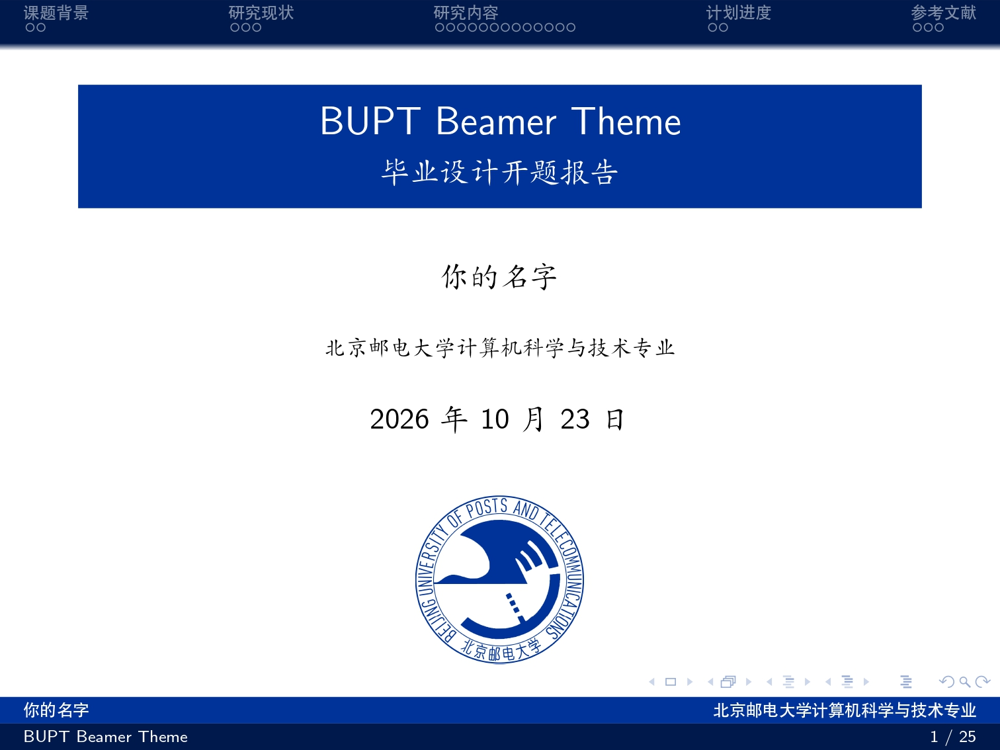
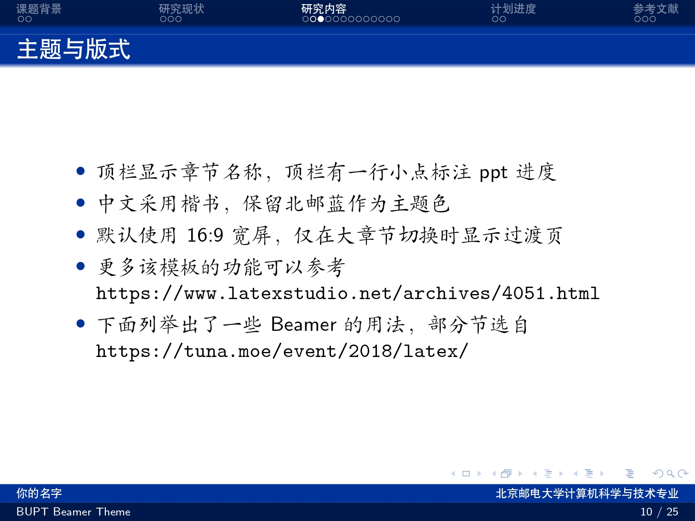
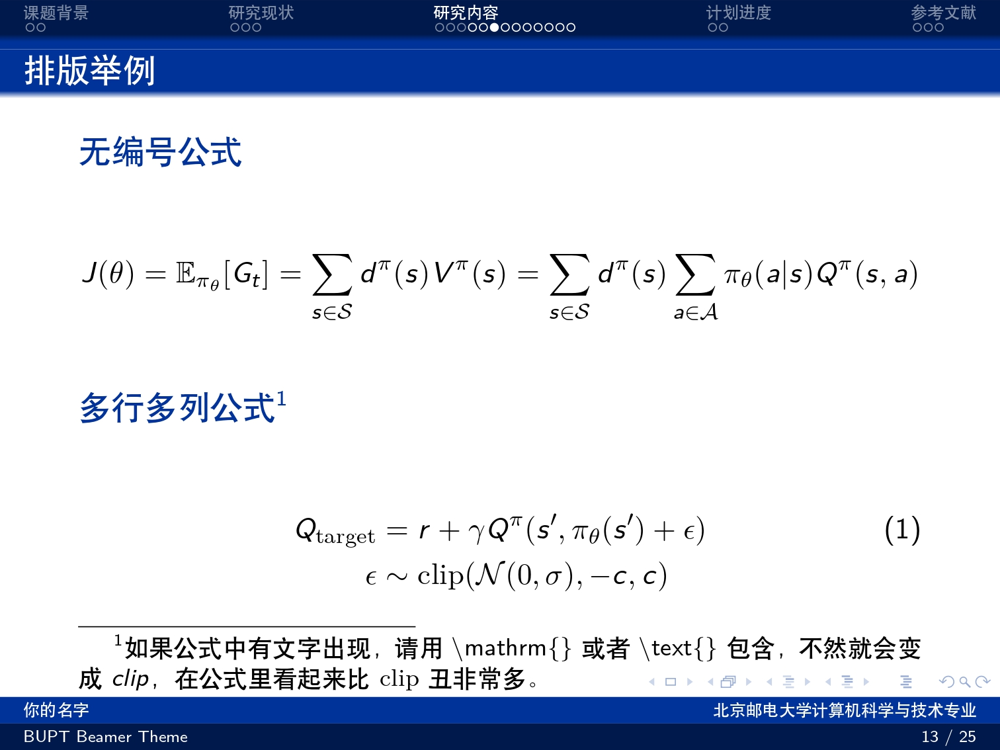
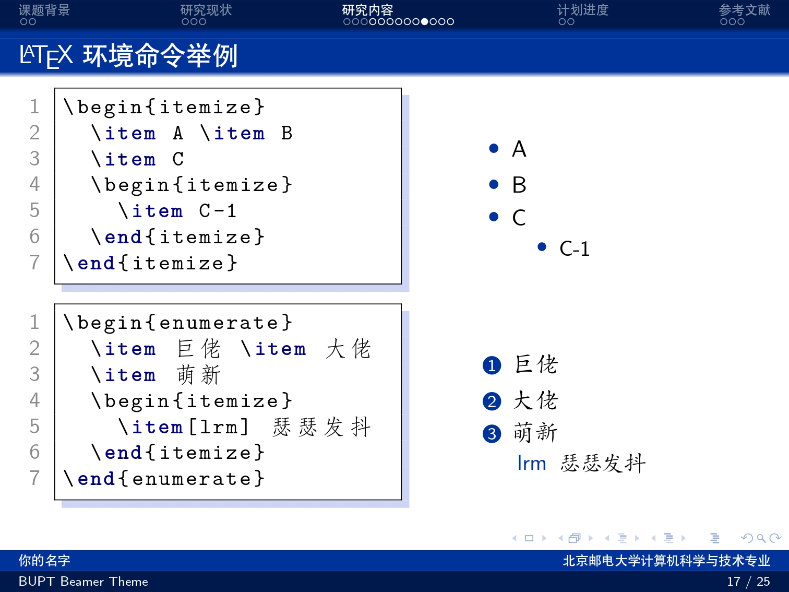

# BUPT-Beamer-Theme

北京邮电大学 Beamer 主题，适用于学术报告、毕业答辩和日常分享。

当前示例采用 **4:3 画幅、中文楷书正文、单行章节导航和北邮蓝（#003399）页脚**，保留标题渐变与阴影。章节和小节开始时都会插入目录过渡页，过渡页计入页脚帧数。

## 快速使用

下载或克隆完整仓库，修改 `slide.tex` 中的标题、作者、院系和正文，使用 **XeLaTeX** 编译。图片放在 `pic/`，参考文献放在 `ref.bib`。

本地编译需要 **XeLaTeX、BibTeX、latexmk、Ghostscript 和 PSTricks**。在 WSL Ubuntu 的仓库根目录运行：

```sh
latexmk slide.tex
```

报告输出为根目录的 `slide.pdf`。项目的 `.latexmkrc` 统一选择 XeLaTeX，自动处理参考文献和重复编译，并为 Ghostscript 配置 PSTricks 所需文件的读取权限。也可以显式指定引擎：

```sh
latexmk -xelatex -synctex=1 -interaction=nonstopmode -file-line-error slide.tex
```

VS Code 通过 Remote - WSL 打开本目录，运行 `LaTeX Workshop: Build LaTeX project`（默认快捷键 `Ctrl+Alt+B`）。工作区默认配方为 `BUPT XeLaTeX`；如需手动选择，运行 `LaTeX Workshop: Build with recipe`。插件和终端均会读取同一份 `.latexmkrc`。直接运行 `xelatex` 不会读取这份配置，当前 Ubuntu 环境应使用上述 latexmk 命令。

修改后再次运行编译命令即可。需要清理重建、仅清理辅助文件或删除全部编译结果时，分别运行：

```sh
latexmk -gg slide.tex  # 清理并完整重建
latexmk -c slide.tex   # 保留最终 PDF
latexmk -C slide.tex   # 连同最终 PDF 一起清理
```

当前 TeX Live 2022 的 PGF 渐变遮罩宏有一处展开顺序错误，`bupt.sty` 在匹配到旧代码时局部修补，保留原来的渐变与阴影。Fandol 字体的 `Script "CJK"` 提示是脚本标签兼容警告，字体可以正常加载；主题保留楷书，不屏蔽该警告。

在 Overleaf 中上传仓库文件，将主文件设为 `slide.tex`，编译器选为 **XeLaTeX**。中文字体由 `ctex` 根据环境选择，无需填写本机字体路径。

完整教程含 PSTricks 绘图和代码示例，需要 `ctex`、`pstricks`、`listings`、`stackengine` 等宏包。若精简 TeX 环境提示缺少 `.sty`，按报错补齐对应宏包，或先使用下面的最小示例。

## 最小示例

从空白文件开始时，将 `bupt.sty` 放在同一目录，保存以下内容为 `.tex` 文件，用 XeLaTeX 编译：

```tex
\documentclass{beamer}
\usepackage{ctex}
\usepackage{bupt}

\title[报告短标题]{完整报告标题}
\author{姓名}
\institute{北京邮电大学}
\date{\today}

\begin{document}
\begin{frame}
  \titlepage
\end{frame}

\section{研究背景}
\begin{frame}{研究问题}
  \begin{itemize}
    \item 在这里填写正文。
  \end{itemize}
\end{frame}
\end{document}
```

常用调整：

- **页脚文字过长**：使用 `\title[短标题]{完整标题}`、`\author[报告人]{完整作者名单}`。
- **顶栏章节太多或太长**：精简章节，或使用 `\section[短节名]{完整章节标题}`。
- **调整画幅**：当前 `slide.tex` 默认是 4:3；需要宽屏时使用 `\documentclass[aspectratio=169]{beamer}`，并检查图表宽度。
- **只改报告内容**：编辑 `slide.tex`；主题颜色、导航和页脚样式集中在 `bupt.sty`。

## 预览

以下图片来自当前 `slide.tex`，完整示例见 [教程 PDF](BUPT-Beamer-Theme.pdf)。

 
 

## 可选在线工具

以下是一些比较好用的 LaTeX 在线工具：

- [Tables Generator](https://www.tablesgenerator.com/)：可视化编辑表格并导出 LaTeX。
- [Mathpix](https://mathpix.com/)：识别公式图片并转换为 LaTeX。
- [DBLP](https://dblp.uni-trier.de/)：检索计算机领域论文及 BibTeX。
- [LaTeX 图、表与图注说明](https://en.wikibooks.org/wiki/LaTeX/Floats,_Figures_and_Captions#Tip)：查阅浮动体、插图和图注用法。

## 文件说明

| 路径 | 内容 |
| --- | --- |
| `slide.tex` | 可直接修改的报告与教程源码 |
| `bupt.sty` | 北邮主题样式 |
| `ref.bib` | 示例参考文献 |
| `.latexmkrc` | latexmk 的项目编译配置，指定 XeLaTeX 引擎，并配置 PSTricks 图形转换及相关文件读取权限 |
| `.vscode/settings.json` | VS Code 的工作区配置，为 LaTeX Workshop 设置默认的 `BUPT XeLaTeX` 编译配方 |
| `pic/` | 报告使用的图片 |
| `img/` | README 预览图片 |
| `BUPT-Beamer-Theme.pdf` | 从当前源码编译的示例与教程 |

## 维护与发布

修改示例或主题后，运行 `latexmk slide.tex` 重新编译，检查版面后再提交。若要另行发布教程 PDF 或预览图，请从本次生成的 `slide.pdf` 导出。

`latexmk -c slide.tex` 清理辅助文件、保留最终 PDF；`latexmk -C slide.tex` 连同最终 PDF 一起清理。两者都保留源码与 `pic/` 素材。

## 致谢

本项目主体基于 [TUNA / THU-Beamer-Theme](https://github.com/tuna/THU-Beamer-Theme) 由本人修改与维护，部分修改使用 Codex 辅助完成。模板示例内容和 README.md 文档基于 [inFaaa / PKU-Beamer-Theme](https://github.com/inFaaa/PKU-Beamer-Theme)修改。相关主题实现与历史背景可参考上游项目。
